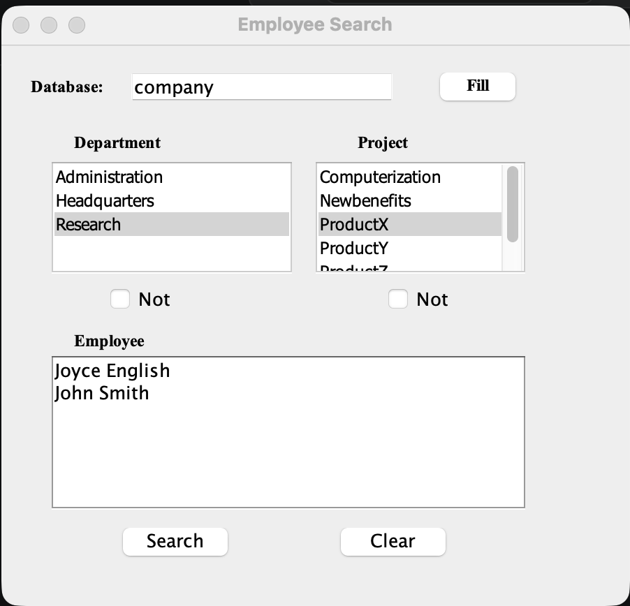

# DatabaseProject

CSCI 4055 group project. Java Swing program that loads the departments and projects
from a database using the COMPANY schema, then searches for employees that are in
(or not in) the departments and projects you pick.

Starts from Dr. Smith's template: https://github.com/proflon/CSCI4055-2025

Group: Pankaj Bhatta, Anupam Adhikari, Christiana

## Setup

1. Install MySQL (8.x) and make sure the server is running.
2. Load the test data: open `sql/company.sql` in MySQL Workbench and run it,
   or from a terminal: `mysql -u root -p < sql/company.sql`
3. Copy `db.properties.example` to `db.properties` (same folder) and put your
   MySQL user and password in it. `db.properties` is ignored by git so your
   password stays on your machine.
4. In Eclipse: File > Import > General > Existing Projects into Workspace, pick
   this folder. The MySQL driver in `lib/` is already on the build path.
5. Run `EmployeeSearchFrame.java`, type `COMPANY` in the Database box and press Fill.

Running from a terminal instead (from the project folder):

```
javac -d bin -cp lib/mysql-connector-j-9.1.0.jar src/*.java
java -cp bin:lib/mysql-connector-j-9.1.0.jar EmployeeSearchFrame
```

On Windows use `;` instead of `:` in the `-cp` part.

## Files

- `src/EmployeeSearchFrame.java` the window (template from Dr. Smith)
- `src/DatabaseConnection.java` opens the database, loads department and project names
- `lib/` MySQL Connector/J 9.1.0
- `sql/company.sql` COMPANY database from the textbook, for testing

## Tools used
- Visual Studio Code (Extension Pack for Java) and WindowBuilder (Eclipse plugin used for Dr. Smith's original Swing template layout; sizes and scroll panes updated in code)
- Java JDK 21 (OpenJDK Temurin 21.0.13.1) with Swing (`javax.swing`) for the GUI
- MySQL Community Server 8.4 and MySQL Workbench for the database
- MySQL Connector/J 9.1.0 (JDBC driver, in `lib/`)
- Git and GitHub for version control

## Screenshot


## Who did what
- Pankaj Bhatta: repo and Eclipse setup, DatabaseConnection class, Fill button and error pop-up
- Anupam Adhikari: scrollable lists, multiple selection, layout, Clear button, tools documentation
- Christiana: search query with the Not options, Search button, testing
